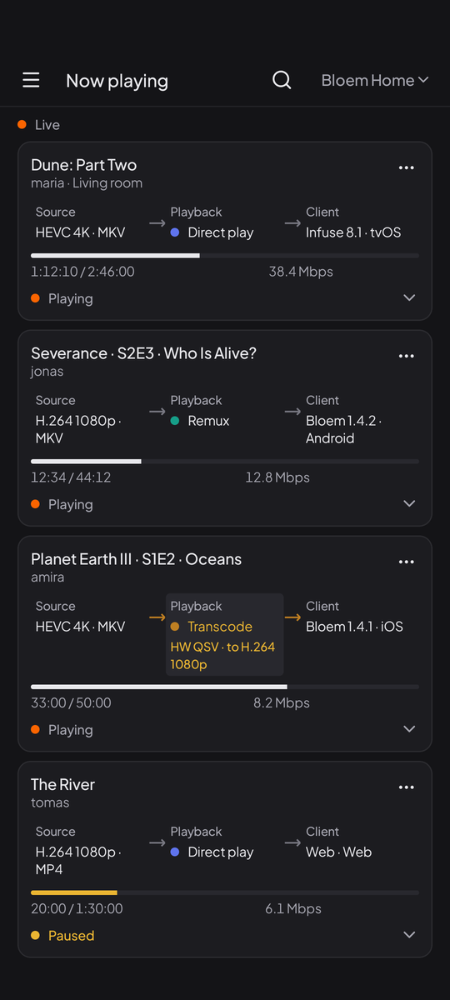
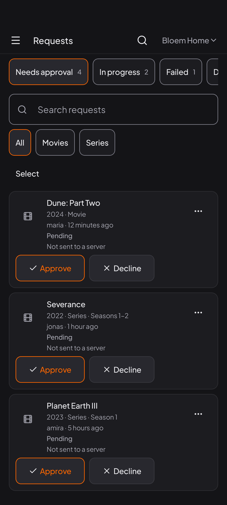
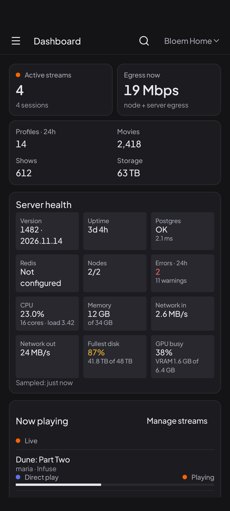

# Bloem Admin for Android

> [!CAUTION]
> **Offered without support.** Bloem Admin is provided as-is, with no support of any kind. Issues are turned off, questions go unanswered, and pull requests are not accepted: they are closed without review. You are free to fork it under the AGPL v3.

Bloem Admin is an Android app (Kotlin, Jetpack Compose) for people who run a media server. It looks after one or more
[Silo](https://siloserver.org) servers from a phone or tablet: watch and control live streams, review playback history,
run and schedule background jobs, handle media requests, manage users, sessions and devices, read the audit and
application logs, and restart the server.

It works with **any Silo server**. When the server it is connected to is a Bloem server, the extras that only a Bloem
server offers (organizations, support access, push notifications) switch on by themselves. On a plain Silo server they
are simply absent. You need an administrator account on the server. The app is not a media player.

| Now playing | Requests | Dashboard |
|---|---|---|
|  |  |  |

These screenshots are drawn from built-in sample data. No real server, user or library appears in them.

## Using it

1. Add a server by its HTTPS address, then sign in with an administrator account: a username and password, or
   **Sign in with <provider>** for each sign-in provider the server offers to apps (it opens your browser and returns to
   the app).
2. Open the drawer to move between pages: Dashboard, Now playing, Playback history, Scheduled tasks, Requests, Users, Logs and
   the server's own settings. The server switcher in the top bar changes the server, or shows all of them together.
3. The foot of the drawer holds **Manage servers**, **Settings** and **Sign out**. **Settings** is a page with Appearance
   (System, Light or Dark), an optional app lock that asks for your fingerprint, face or device PIN, and Server alerts and
   push notification switches.

The [user guide](docs/user-guide.md) walks through every screen.

## Get the app

Signed release APKs are on the GitHub Releases page of
[Bloem-Studios/bloem-admin-android](https://github.com/Bloem-Studios/bloem-admin-android/releases). Each release lists a SHA-256 checksum next to
the APK. Android 8.0 (API 26) or newer is required. Install the APK by opening it on the device and allowing installs from
your browser or file manager when Android asks.

Updates install over the top of an earlier release of the same app, because every release is signed with the same key.
There is no in-app updater.

## Build it yourself

You need JDK 17 and the Android SDK (platform 36). Point `ANDROID_HOME` at the SDK, or put `sdk.dir=...` in
`local.properties`.

```sh
./gradlew assembleDebug          # app/build/outputs/apk/debug/app-debug.apk
./gradlew testDebugUnitTest      # unit tests
./gradlew lintDebug              # Android lint
./gradlew assembleRelease        # shrunk release APK; unsigned unless you provide a signing key
```

A fresh clone builds with no private files. Two things are optional and kept out of the repository:

- **Push notifications** need the `google-services.json` of Bloem's Firebase project, which only the official build has. Without it the app builds and runs normally, and Settings says
  push is not available in this build. See [docs/push.md](docs/push.md).
- **Release signing** needs your own keystore. See [docs/releasing.md](docs/releasing.md).

Builds you make yourself are signed with a different key from the official releases, so Android will not install one over
the other. Uninstall first, which clears the app's saved servers and sign-ins.

## Documentation

- [docs/features.md](docs/features.md): the complete feature list, permissions and architecture notes
- [docs/user-guide.md](docs/user-guide.md): every screen, for the administrator using the app
- [docs/admin-guide.md](docs/admin-guide.md): build, signing, distribution and how the app talks to a server
- [docs/releasing.md](docs/releasing.md): how a maintainer cuts a release
- [docs/push.md](docs/push.md): push notifications and the Firebase config
- [docs/design.md](docs/design.md): the look rules: colours, type, spacing, icons and copy

## Security

If you find a vulnerability, read [SECURITY.md](SECURITY.md). It is a courtesy, not a support channel.

## Licence

Bloem Admin is free software under the [GNU Affero General Public License v3.0](LICENSE). Fonts, icons and libraries it
includes keep their own licences, listed in [THIRD_PARTY_NOTICES.md](THIRD_PARTY_NOTICES.md). The licence covers the code.
It does not grant any right to the Bloem name or logo.
